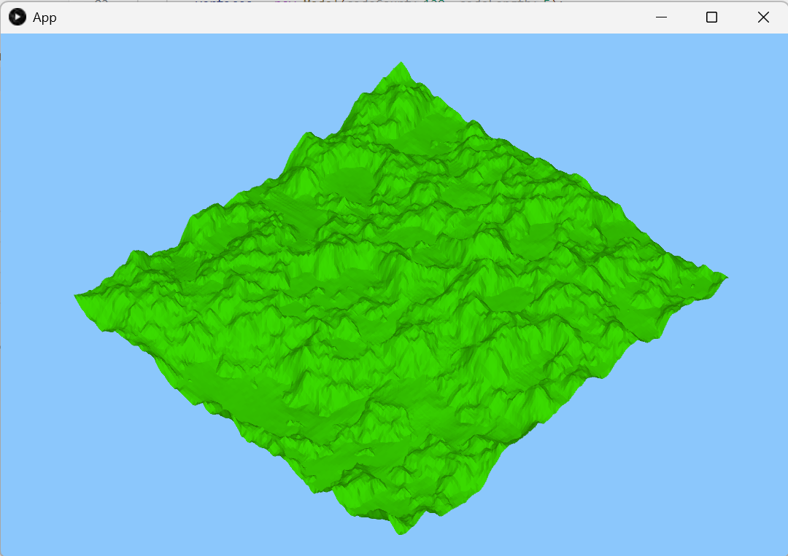

# Procedural Hydrology

A Java/Processing project that generates terrain and simulates its interaction with water particles and how they erode the terrain over time using newtonian mechanics.

This project is inspired by the blog post: https://nickmcd.me/2020/04/10/simple-particle-based-hydraulic-erosion/

## Features

- Base terrain generation using perlin noise
- Calculation of forces acting on water drops using surface normal and speed of water
- Introduces the concept of changing the shape of landmass by calculating the volume of sediment deposits

## Running this project

- Make sure you have Maven and Java in system environment
- run mvn compile, mvn package and java -jar target\'generated-jar.java'

